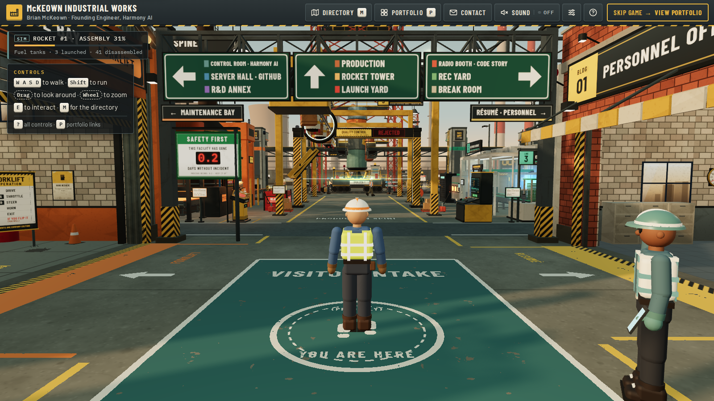
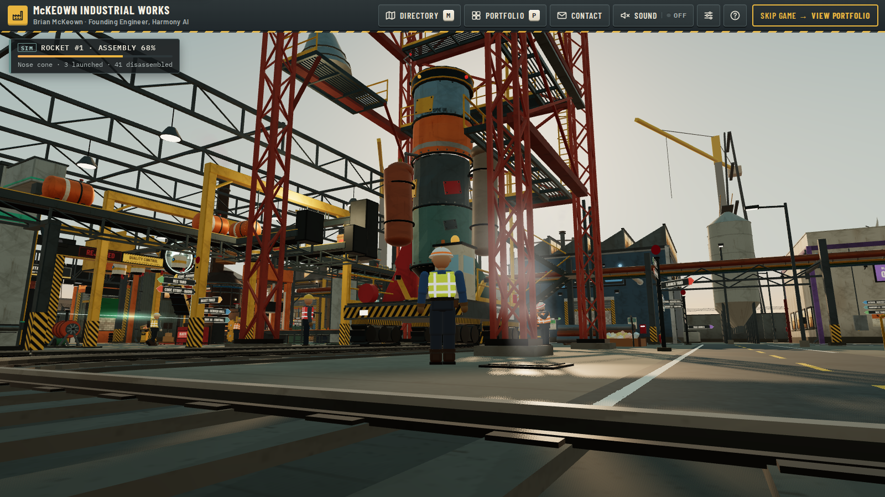
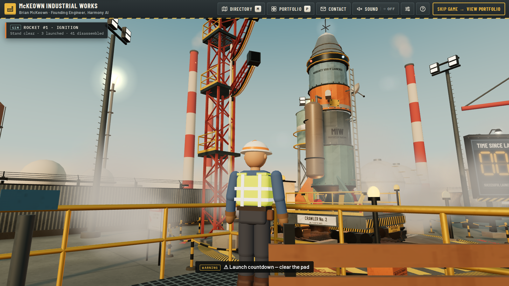
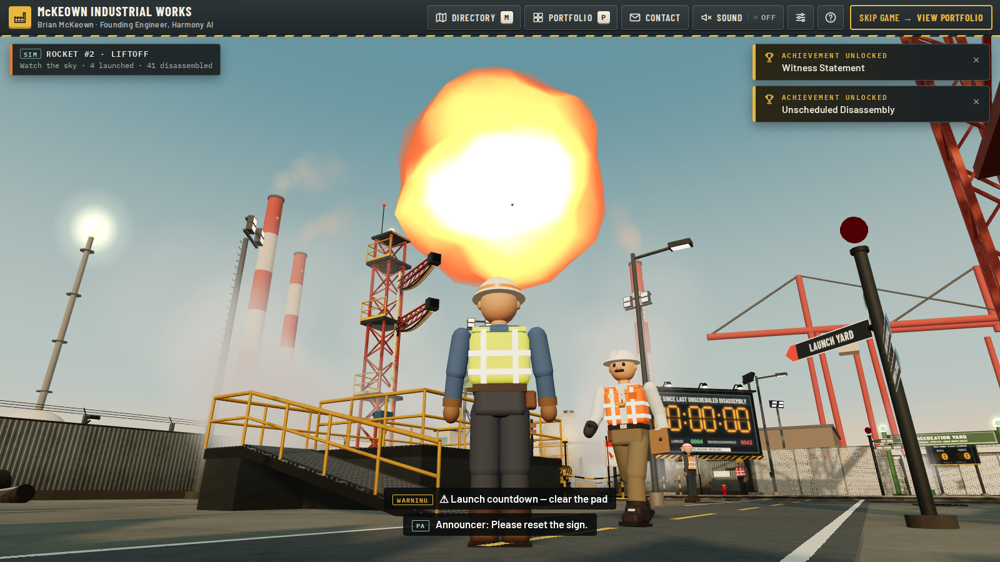
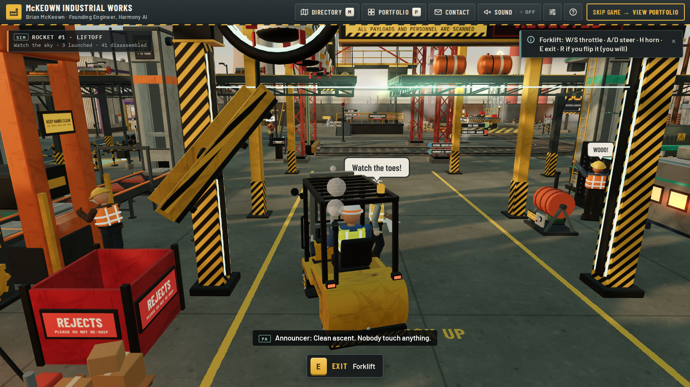
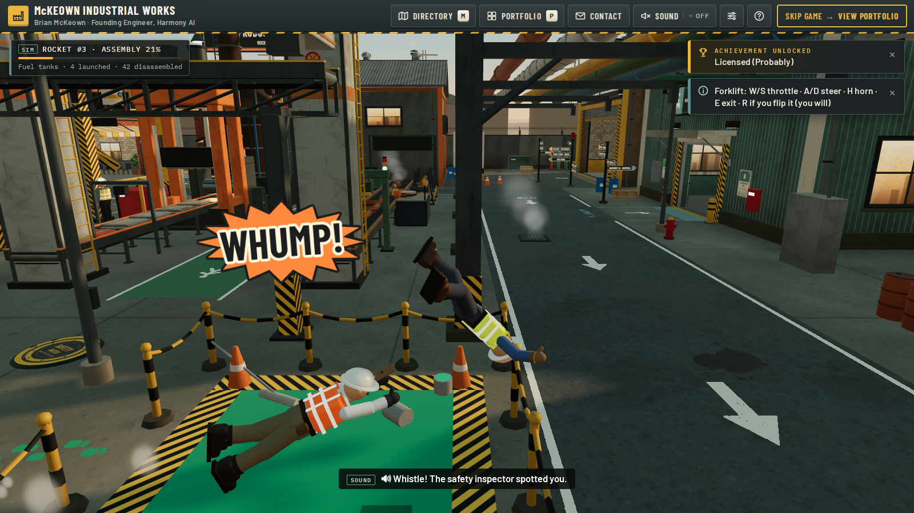
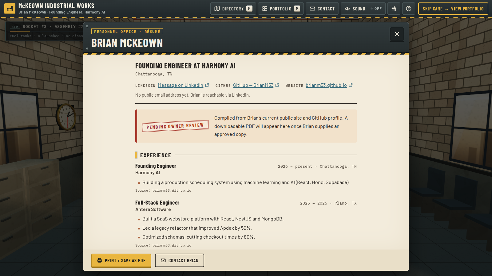

# McKeown Industrial Works

**Brian McKeown's portfolio, built as a small, ridiculous, freely explorable 3D factory.**
Walk an anonymous hard-hat worker around a dense industrial campus with a third-person orbit camera. You can find the résumé, Harmony AI, the Code Story interview and the GitHub projects, drive a forklift, get tackled by a safety inspector, and watch a production line build and launch extremely questionable rockets.

> *The factory can be dysfunctional. The website cannot.*

- **Live site:** https://brianm53.github.io/mckeown-industrial-works/ (also on Google Cloud Run: https://mckeown-industrial-works-130645867703.us-central1.run.app/)
- **Plain HTML portfolio (no 3D, no JavaScript needed):** https://brianm53.github.io/mckeown-industrial-works/portfolio/
- **Lite mode inside the app:** append `?lite=1`

Every real fact on the site (role, résumé, projects, podcast, links) comes from `src/content/*.ts`, sourced from Brian's own GitHub profile, his current site, the Code Story episode page and tryharmony.ai. The factory's workers, the "CEO" mythology, production numbers, launch results and safety incidents are labelled as fiction. See [`docs/OWNER_REVIEW.md`](docs/OWNER_REVIEW.md) for the items awaiting Brian's confirmation.



| | | |
|---|---|---|
|  |  |  |
|  |  |  |

More screenshots (control room, server hall, rec yard, R&D annex, night shift, mobile, lite mode, static page) are in [`docs/screenshots/`](docs/screenshots/README.md).

---

## Quick start

Requires Node ≥ 20.19 (22 LTS recommended). No secrets, tokens or paid APIs.

```bash
npm install
```

```bash
npm run dev
```

Open http://127.0.0.1:5173. `/portfolio/` also works in dev.

| Command | What it does |
|---|---|
| `npm run dev` | Vite dev server with hot reload (debug hooks enabled) |
| `npm run build` | Typecheck, production build to `dist/`, then prerender the static portfolio, sitemap, robots, 404 and health files |
| `npm run preview` | Serve `dist/` at http://127.0.0.1:4173 |
| `npm test` | Unit and component tests (Vitest + Testing Library, jsdom) |
| `npm run typecheck` | `tsc --noEmit` over the whole repo |
| `npm run build:test` | Build with the `window.__MIW__` test hooks to `dist-test/` |
| `npm run test:e2e` | Playwright end-to-end suite against `dist-test/` (starts `preview:test` itself) |
| `npm run test:all` | Typecheck, unit, test build and e2e, in that order |
| `npm run smoke -- <url>` | HTTP smoke check of a running or deployed site (`/`, `/portfolio/`, `health.json`, …) |
| `npm run check:links -- --network` | Validate every configured external link (marks unverified ones for owner review) |
| `npm run shot -- --out shots/x.png` | Headless screenshot and driving helper (see the header of `scripts/shot.mjs`) |

First-time Playwright setup: `npx playwright install chromium`.

## Controls

| Action | Keyboard / mouse | Touch |
|---|---|---|
| Walk | W A S D or arrow keys (camera-relative) | Left joystick |
| Run | Shift (hold) | Run button |
| Look around | Drag with the left or right mouse button · `,` `.` (or J / L) | Drag on the right side |
| Tilt / zoom | Drag up/down · I / K · mouse wheel · `-` `=` | Drag · pinch |
| Recenter camera | C | Recenter button |
| Interact / talk / drive | E | Interact button |
| Recover / unstick | R | Recover button |
| Site directory & map | M | Map button |
| Portfolio quick links | P | Menu button |
| Help · close / pause | ? · Esc | — |
| Forklift horn | H or Space | Horn button (while driving) |

Mouse-look with pointer lock is opt-in under Settings. Sound is opt-in: nothing plays until you press **Sound**. Settings also has independent master, music and SFX sliders, captions, reduced motion, ambient-event toggles, quality tier and camera sensitivity.

**You never have to play the game:** the top bar's *Directory*, *Portfolio*, *Contact* and *Skip game → View portfolio* reach every real piece of content in one click. The site falls back to the HTML portfolio automatically when WebGL is unavailable.

## Editing the portfolio content

All real content is typed data, separate from rendering:

| File | Contents |
|---|---|
| `src/content/profile.ts` | Name, headline, summary, location, GitHub/LinkedIn/website links, **email (null until you add one)** |
| `src/content/resume.ts` | Experience, education, skills, **`pdfUrl`** (set it after putting the PDF in `public/`), status |
| `src/content/projects.ts` | Repositories shown in the Server Hall; `featured: true` also puts a machine in the R&D Annex |
| `src/content/stations.ts` | Harmony AI copy, Code Story episode + links, Rec Yard copy |
| `src/content/dialogue.ts` | NPC dialogue (fiction) |
| `src/content/achievements.ts`, `controls.ts` | Achievement list and control bindings |

The HTML panels, the static `/portfolio/` page, the JSON-LD profile and the link checker all read these files. Run `npm run check:links -- --network` after editing links.

## Configuration & deployment

Build-time environment variables (none are secret; see `.env.example`):

| Variable | Default | Purpose |
|---|---|---|
| `BASE_PATH` | `/` | Public base path; `/mckeown-industrial-works/` for the GitHub Pages project site |
| `SITE_URL` | `https://brianm53.github.io/mckeown-industrial-works/` | Absolute URL for canonical/Open Graph tags, sitemap and robots |
| `OUT_DIR` | `dist` | Build output directory |
| `VITE_TEST_HOOKS` | `false` | Keep `window.__MIW__` debug hooks in a build (test builds only; never public) |

**GitHub Pages (live):** run

```bash
npm run deploy:pages
```

It typechecks, builds with `BASE_PATH=/mckeown-industrial-works/`, prerenders the static pages and force-pushes the output to the `gh-pages` branch. Pages is set to *Deploy from a branch → gh-pages /*, and GitHub publishes the update in about a minute. Verify with `npm run smoke -- https://brianm53.github.io/mckeown-industrial-works/` and `npm run check:live -- https://brianm53.github.io/mckeown-industrial-works/ shots/live.png`. HTTPS and gzip are automatic. Hashed `assets/*` are cacheable, and `404.html` provides the SPA fallback.

There is also a fully automated workflow, `.github/workflows/deploy.yml`: typecheck, unit tests, build, smoke test, then `actions/deploy-pages`. It is currently set to manual (`workflow_dispatch`) because **GitHub Actions jobs refuse to start on this account ("account is locked due to a billing issue")**. Once that's resolved, restore its `push: branches: [main]` trigger (see the comment in the file) and switch Settings → Pages → Source to *GitHub Actions*.

**Google Cloud Run (live):** https://mckeown-industrial-works-130645867703.us-central1.run.app/ (project `mckeown-industrial-works`, region `us-central1`). Run

```bash
npm run deploy:gcp
```

It builds with `BASE_PATH=/` and `SITE_URL` set to the Cloud Run URL, bakes `dist-gcp/` into an nginx image (`deploy/cloudrun/`), smoke-tests that image locally, pushes it to Artifact Registry and deploys it (scale to zero, at most 3 instances), then smoke-tests the live URL. nginx sends the same security headers and cache rules as `netlify.toml`. Needs `gcloud` logged in, Docker, and billing on the project. Set `SITE_URL` when you add a custom domain; `LOCAL_ONLY=1` stops after the local test.

**Netlify / Vercel:** `netlify.toml` and `vercel.json` provide the same build plus long-cache headers for hashed assets, no-cache HTML, security headers (including a CSP compatible with Rapier WASM) and an SPA fallback that doesn't shadow `/portfolio/`. Set `SITE_URL` to your domain and leave `BASE_PATH=/`.

**Any static host:** `npm run build`, upload `dist/`, route unknown paths to `index.html` (or use `404.html`), and run `npm run smoke -- https://your.site/`.

## Architecture

Vite 7 · React 19 · TypeScript (strict) · three.js r187 via React Three Fiber 9 and drei 10 · Rapier physics (`@react-three/rapier`, fixed 60 Hz step, interpolation) · zustand. No backend: it's a static site.

```
src/
  app/          entry shell: WebGL detection, fallback switch, deep links (?panel=, ?lite=1)
  core/         contracts: typed event bus, actions, services, per-frame runtime, interaction registry,
                sim clock, seeded RNG, collision groups, math/orientation conventions, debug hooks
  state/        zustand stores: ui (panels, prompt, route, fade), settings (persisted), game
  content/      owner-editable real content + fiction (dialogue)
  world/        layout.ts (the single map of the campus), nav graph, Scene composition, WorkerModel,
                shared materials/palette, physics base
  player/       character controller (Rapier KCC), spring-arm orbit camera, input, interaction,
                recovery, route guide
  environment/  ground, roads, buildings with roof cutaways, signage, lighting, skyline, decor
  systems/      factory simulation (5 lines, rocket FSM, optimization model), event director (humor pacing)
  factory/      production lines 3D, rocket tower/launch 3D, Line Supervisor Console panel
  stations/     Personnel Office, Control Room, Broadcast Booth, Server Hall, Rec Yard, R&D Annex
  npc/          workers, routes, dialogue, ambient gags
  safety/       site safety inspector (restricted zones → tackle), Night Shift, PA announcer
  vehicles/     forklift + bumpable props
  audio/        procedural WebAudio: music, spatial machinery, event sounds, mixer
  ui/           HTML overlay: top bar, HUD, panels, directory/map, settings, touch controls
  portfolio/    static HTML portfolio (prerendered to /portfolio/) and the in-app fallback
```

Each world module is lazy-loaded into an isolated slot with its own error boundary, so one module failing never takes down the rest. `three`, R3F and Rapier load only with the 3D view, so lite and no-WebGL visitors download about 85 kB gzipped of UI and content. Deeper details: [`docs/ARCHITECTURE.md`](docs/ARCHITECTURE.md). Product spec: [`docs/SPEC.md`](docs/SPEC.md).

**Debug/test hooks.** Dev and test builds expose `window.__MIW__` (`player`, `camera`, `interaction`, `factory`, `clock`, `forklift`, `osha`, `nightShift`, `npc`, `audio`, `ui`, `settings`, `core`, `perf`, …). Production builds strip them. URL params: `?quality=low|medium|high`, `?seed=123`, `?spawn=<zoneId>`, `?panel=resume`, `?noevents=1`, `?timescale=4` (dev/test), `?lite=1`.

## Quality, tests & performance

- Unit and component tests: `npm test` (Vitest). They cover contracts, the factory model and launch FSM, OSHA and Night Shift FSMs, NPC routes, dialogue rules, forklift logic, audio consent, UI panels, accessibility contrast and more.
- End-to-end: `npm run test:e2e` (Playwright) covers the 18 must-pass checks from the spec (§12), plus mobile, no-WebGL fallback and axe-core scans.
- Results: [`docs/TEST_RESULTS.md`](docs/TEST_RESULTS.md): typecheck clean, 850 unit tests, 61/61 e2e (two consecutive green runs), live smoke 11/11.
- Performance: [`docs/PERF.md`](docs/PERF.md) (`node scripts/perf.mjs`). Measured on a weak integrated GPU (Intel UHD via WSL2/D3D12) at 1280×720: 27–51 fps across tiers. Medium tier peaks at ~294 draw calls and ~635k triangles, including the shadow pass. The top bar is interactive within 0.15–2.4 s. Shaders now precompile behind the loading screen instead of stalling the first frames.
- Known limitations and deferred ideas: [`docs/STATUS.md`](docs/STATUS.md).

## Credits & licenses

All 3D geometry, textures and audio are original and procedural. Fonts are Barlow and IBM Plex Mono (SIL OFL 1.1). See [`ASSET_LICENSES.md`](ASSET_LICENSES.md).
